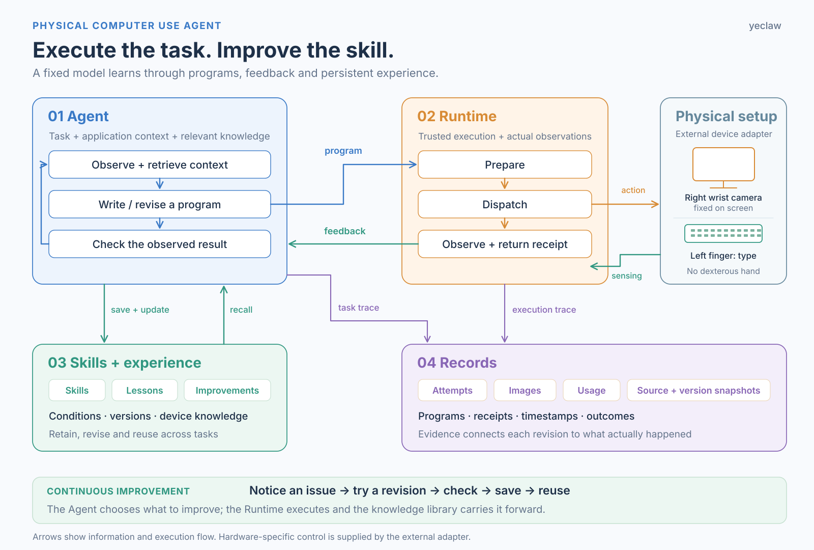
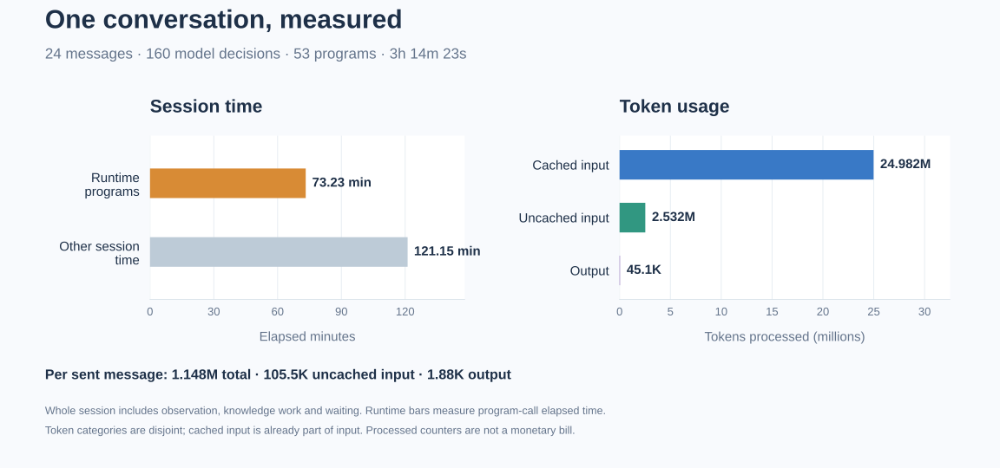

# Physical Computer Use Agent

**By yeclaw** · [简体中文](README.zh-CN.md) · [Apache-2.0](LICENSE)

An agent that learns, repairs and reuses physical computer-use skills.

## Why a robot at the keyboard?

I first tried to let Astra chat in WeChat on a Mac, but ran into failed text input and unexpected exits. I suspected a WeChat protection mechanism, though the cause was never confirmed. So I tried a physical interface instead: cameras read the display, and a robot presses the keyboard.

With the recent interest in Physical RSI, this became a chance to try it on a concrete task: let the agent explore, learn from feedback, revise its action programs, and retain useful skills and lessons for later use. The same agent handles everyday tasks and improves how it performs them, with fixed model weights.

The hardware uses ordinary grippers, with no dexterous hands. The right arm stays still, using its wrist camera to watch the display; one finger of the left gripper taps the physical keyboard.

[Demos](#demonstrations) · [Architecture](#architecture) · [Session usage](#one-chat-session-in-numbers) · [Quickstart](#quickstart) · [Open questions](#limits-and-open-questions)

## Demonstrations

### 01 · First, the final result

Let's start with the final result: Astra chats with Yuanbao by reading the monitor and typing on a physical keyboard. The four clips below cover all 24 sent messages, in order.

<table>
<tr>
<td width="50%" valign="top">

**Conversation · Part 1**

https://github.com/user-attachments/assets/a1598b21-fe4b-4a5d-bfea-629bc18a569c

</td>
<td width="50%" valign="top">

**Conversation · Part 2**

https://github.com/user-attachments/assets/8c23d8ca-921c-4577-ba2e-3ab44c079799

</td>
</tr>
<tr>
<td width="50%" valign="top">

**Conversation · Part 3**

https://github.com/user-attachments/assets/5bbd2de5-8321-4155-894e-54532726cdc0

</td>
<td width="50%" valign="top">

**Conversation · Part 4**

https://github.com/user-attachments/assets/df2be0fb-dd5b-4d7f-a9d3-c4317f3e6c73

</td>
</tr>
</table>

### 02 · Learn new keys from a few demonstrations

The original plan was to let Astra learn every key through its own exploration, but progress was slow and token use was high. Inspired by [SenseNova-RoboRSI](https://github.com/OpenSenseNova/SenseNova-RoboRSI), we then tried supplying demonstrations for a few keys and letting Astra learn other keys in context (ICL).

The supplied letter demonstrations are `r`, `u`, `f`, `j`, `v` and `n`; the clips show how Astra uses those references together with observations and execution feedback.

<table>
<tr>
<td width="50%" valign="top">

**Learning g · references from f/j**

https://github.com/user-attachments/assets/25b7a981-bdb4-4165-a822-9782e9dfb0c5

</td>
<td width="50%" valign="top">

**Learning e · references from r/u**

https://github.com/user-attachments/assets/0546c9cc-7fd5-4901-8d3d-90dee903c188

</td>
</tr>
</table>

#### Compose hello from learned key skills

https://github.com/user-attachments/assets/8fbe4d19-7809-4218-b7bf-6936c5abe540

### 03 · From individual skills to continuous typing

Learning individual keys did not yet make typing efficient. Executing keys one at a time and repeatedly pausing for a visual check required more model calls and repeated inputs. We therefore asked Astra to keep improving: compose learned key actions into continuous programs for a word or short phrase, then use execution feedback to revise and save the skill.

<table>
<tr>
<td width="50%" valign="top">

**5w5w5w5 · continuous input in one program**

https://github.com/user-attachments/assets/2d177612-0dc3-4d08-ba2e-52104057993f

</td>
<td width="50%" valign="top">

**Enter · a complete reusable round trip**

https://github.com/user-attachments/assets/a1874403-85fc-42e1-bdda-3511520a72ce

</td>
</tr>
<tr>
<td width="50%" valign="top">

**move up · a phrase with a space**

https://github.com/user-attachments/assets/d55fad99-e1fb-4db4-95f1-3a9a2a21399b

</td>
<td width="50%" valign="top">

**Mixed input · 18 characters**

https://github.com/user-attachments/assets/26ac6c4a-3fec-4c5f-9b05-80b3cc3564ad

</td>
</tr>
</table>

The Enter, connected-typing and local repair skills developed on this keyboard were then reused in the Yuanbao conversation shown above.

## Architecture



- **Agent** — choose actions, write programs, check results and decide what to improve.
- **Runtime** — prepare and execute programs through an external device contract, returning actual feedback.
- **Skills + experience** — retain executable skills, Lessons, device knowledge and open improvements.
- **Records** — connect attempts, images, timestamps, usage and program revisions to their evidence.

Applications, model providers and hardware adapters plug into these components. Demonstrations are external learning material; dedicated teleoperation, device calibration and trajectory playback are supplied separately. See [architecture](docs/architecture.md) and [integration](docs/integration.md).

## One chat session in numbers



The chart covers the entire recorded run, including observation, execution, knowledge work and waiting. [Usage summary](examples/results/chat-summary.json) · [160 decision records](examples/results/chat-decision-usage.csv) · [Experiment notes](docs/experiments.md).

## Quickstart

Python 3.11+ on Linux or macOS, from the source root:

```bash
PYTHONDONTWRITEBYTECODE=1 PYTHONPATH=src python3 \
  -m astra_robotics_agent.physical_keyboard.agent.runner \
  --config examples/offline.json \
  --knowledge /tmp/physical-agent-demo-knowledge-new \
  --output /tmp/physical-agent-demo-run-new
```

The offline example exercises execution → feedback → revision → save → inspect → reuse with authored mock decisions and a synthetic device. It requires no model account, robot or OS keyboard input. Choose fresh output/knowledge directories for this fixture; normal use can keep accumulating knowledge.

For installation and the console entry point:

```bash
python3 -m pip install .
physical-agent --config examples/offline.json \
  --knowledge /tmp/physical-agent-installed-knowledge-new \
  --output /tmp/physical-agent-installed-run-new
```

To connect a real setup, supply a trusted device factory and a model session factory in JSON. AgentRunner handles evidence registration, source snapshots and persistent knowledge. The reference provider uses Astra/xhigh/default through Codex; install/login to the CLI and supply model access separately. [Integration guide and runnable external-factory example](docs/integration.md) · [Authentication and private data](docs/privacy.md).

## Limits and open questions

The keyboard, cameras and robot stayed in place. The present results show adaptation to that setup: learned positions, timing, recovery and reusable programs. How much of that improvement is scene memory, and how much is a method that transfers?

The next useful tests are new text, undemonstrated keys, a shifted keyboard and another device—measuring both retained capability and the time/tokens needed to adapt again. We want to learn which experience to reuse, which to revise, and which to discard when the world changes.

Fixed-scene adaptation has practical value. It is also a different claim from general embodied intelligence. Current demonstrations use English keyboard input with an operator-opened, focused window; mouse control and arbitrary desktop workflows remain open.

[Evaluation and related-work notes](docs/related-work.md).

## Acknowledgments

- [EmbodiedEvo](https://github.com/Einsia/EmbodiedEvo) and its authors inspired executable skills and persistent experience. [Paper](https://arxiv.org/abs/2610.18867) · [BibTeX](docs/references.md#embodiedevo).
- [SenseNova-RoboRSI](https://github.com/OpenSenseNova/SenseNova-RoboRSI) and its [empirical report](https://arxiv.org/abs/2610.22471v2) informed the use of demonstrations and robot/interface information as reusable in-context knowledge. [BibTeX](docs/references.md#sensenova-roborsi).

This project builds its own task-focused implementation. Upstream source trees, robot SDKs and private device deployments are not bundled.

## License

Copyright (c) 2026 yeclaw. Code and documentation are available under [Apache-2.0](LICENSE).
