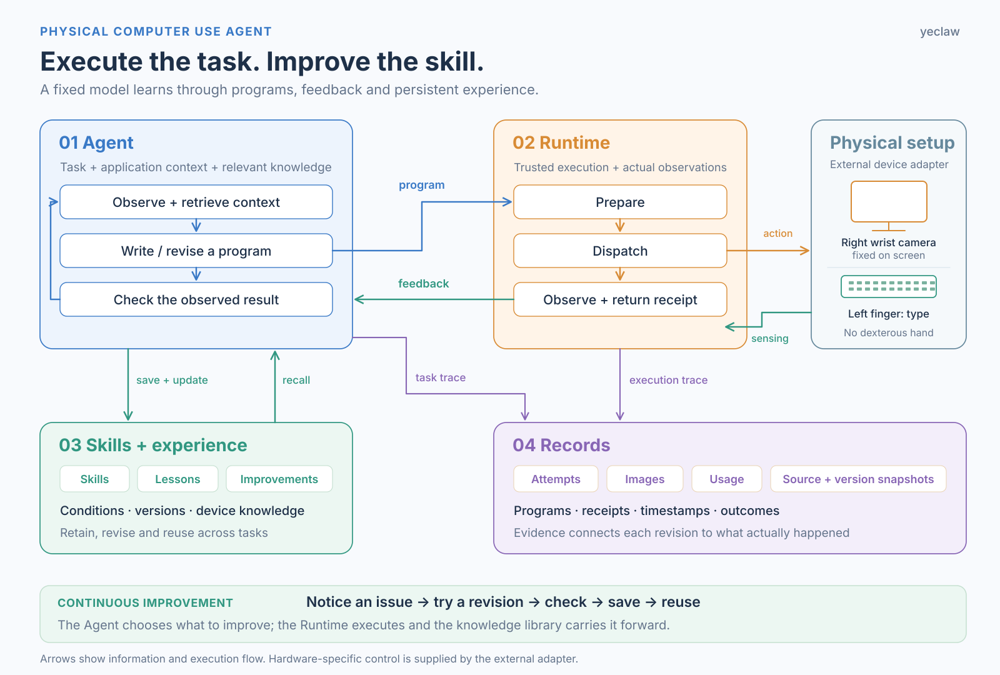
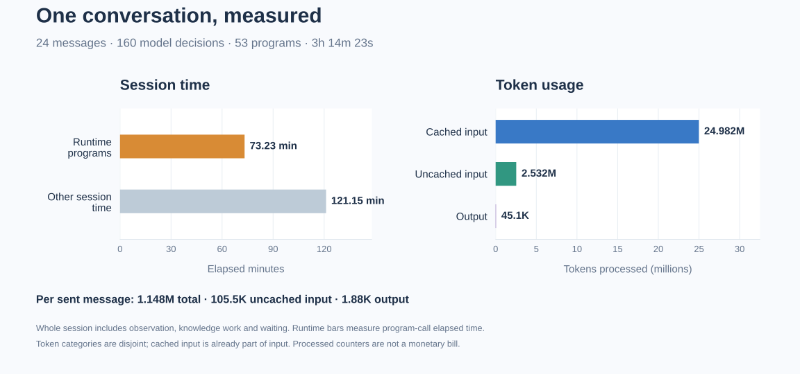

# Physical Computer Use Agent

**作者：yeclaw** · [English](README.md) · [Apache-2.0 许可证](LICENSE)

让 Agent 在真实执行中学习、修订和复用操作电脑的技能。

## 为什么让机器人来敲键盘？

最初我想让 Astra 直接操作 Mac 上的微信聊天，但遇到了无法输入、自动退出等问题。我怀疑与微信的保护机制有关，不过没有确认原因。于是换了一种接入方式：用相机看显示器，让机械臂敲实体键盘。

正好最近 Physical RSI 很受关注，就借这个任务实现并尝试了一下：让 Agent 自己探索、根据反馈修改动作程序，把有用的方法和经验保存下来，之后继续复用。完成日常任务和改进技能由同一个 Agent 负责，基础模型权重不变。

硬件上只用了普通夹爪，没有灵巧手。右臂保持静止，用腕部相机观察显示屏；左臂用夹爪的一个指瓣敲打键盘。

[演示](#演示) · [架构](#架构) · [对话耗时与用量](#一轮对话的耗时与用量) · [快速开始](#快速开始) · [开放问题](#局限与开放问题)

## 演示

### 01 · 先看最终效果：与元宝对话

先来看最终效果：Astra 通过相机读屏，用实体键盘与元宝对话。以下四段按顺序覆盖完整的 24 次发送。

<table>
<tr>
<td width="50%" valign="top">

**元宝对话 · 第 1 段**

https://github.com/user-attachments/assets/a1598b21-fe4b-4a5d-bfea-629bc18a569c

</td>
<td width="50%" valign="top">

**元宝对话 · 第 2 段**

https://github.com/user-attachments/assets/8c23d8ca-921c-4577-ba2e-3ab44c079799

</td>
</tr>
<tr>
<td width="50%" valign="top">

**元宝对话 · 第 3 段**

https://github.com/user-attachments/assets/5bbd2de5-8321-4155-894e-54532726cdc0

</td>
<td width="50%" valign="top">

**元宝对话 · 第 4 段**

https://github.com/user-attachments/assets/df2be0fb-dd5b-4d7f-a9d3-c4317f3e6c73

</td>
</tr>
</table>

### 02 · 用少量示范学习新键位

原本想让 Astra 自己探索并学会所有按键，但学习进度和 token 用量都不太理想。后来参考 [SenseNova-RoboRSI](https://github.com/OpenSenseNova/SenseNova-RoboRSI)，尝试提供部分键位的示范，让 Astra 通过上下文学习（ICL）学习其他按键。

这里提供了 `r、u、f、j、v、n` 六个字母的示范；下面展示它如何结合这些参考、当前观察和执行反馈，学习新的键位。

<table>
<tr>
<td width="50%" valign="top">

**学习 g · 参考 f/j**

https://github.com/user-attachments/assets/25b7a981-bdb4-4165-a822-9782e9dfb0c5

</td>
<td width="50%" valign="top">

**学习 e · 参考 r/u**

https://github.com/user-attachments/assets/0546c9cc-7fd5-4901-8d3d-90dee903c188

</td>
</tr>
</table>

#### 复用已学键位，组合 hello

https://github.com/user-attachments/assets/8fbe4d19-7809-4218-b7bf-6936c5abe540

### 03 · 从单键技能到连续输入

有了单键技能，打字仍然很慢：逐键执行、频繁停下来让 Astra 看图确认，会带来更多模型调用和重复输入，消耗不少 token。于是我们让它继续自主改进，把已学会的按键动作组合成连续输入程序，尝试一次打完一个词或短句，再根据执行反馈修订并保存技能。

<table>
<tr>
<td width="50%" valign="top">

**5w5w5w5 · 一次程序连续输入**

https://github.com/user-attachments/assets/2d177612-0dc3-4d08-ba2e-52104057993f

</td>
<td width="50%" valign="top">

**Enter · 完整往返与复用**

https://github.com/user-attachments/assets/a1874403-85fc-42e1-bdda-3511520a72ce

</td>
</tr>
<tr>
<td width="50%" valign="top">

**move up · 带空格的短句**

https://github.com/user-attachments/assets/d55fad99-e1fb-4db4-95f1-3a9a2a21399b

</td>
<td width="50%" valign="top">

**混合输入 · 18 字符**

https://github.com/user-attachments/assets/26ac6c4a-3fec-4c5f-9b05-80b3cc3564ad

</td>
</tr>
</table>

训练中积累的 Enter、连打和局部修复能力，随后在同一套设备上用于上面的元宝对话。

## 架构



- **Agent**：选择动作、编写程序、检查结果，自主决定如何改进。
- **Runtime**：通过外部设备接口执行完整程序，返回实际观察和动作回执。
- **Skills 与经验**：积累可执行技能、Lesson、设备理解和待优化项。
- **Records**：保存尝试、图像、时间戳、用量及程序版本，并连接来源证据。

模型、应用与设备分别接入。示范是外部学习材料，遥操、设备标定和专用轨迹播放实现独立提供。详见[架构说明](docs/architecture.md)与[接入指南](docs/integration.md)。

## 一轮对话的耗时与用量



图中统计整段实际运行，包括观察、执行、知识维护和等待。[用量汇总](examples/results/chat-summary.json) · [160 次决策记录](examples/results/chat-decision-usage.csv) · [实验详情](docs/experiments.md)。

## 快速开始

Linux／macOS，Python 3.11 以上，从仓库根目录执行：

```bash
PYTHONDONTWRITEBYTECODE=1 PYTHONPATH=src python3 \
  -m astra_robotics_agent.physical_keyboard.agent.runner \
  --config examples/offline.json \
  --knowledge /tmp/physical-agent-demo-knowledge-new \
  --output /tmp/physical-agent-demo-run-new
```

离线示例走通执行 → 反馈 → 修订 → 保存 → 读取 → 复用，决策与设备使用手写 mock，无需模型账号、机器人或系统键盘输入。首次示例选择新的输出／知识目录，日常使用可以持续累积知识。

也可以安装命令行入口：

```bash
python3 -m pip install .
physical-agent --config examples/offline.json \
  --knowledge /tmp/physical-agent-installed-knowledge-new \
  --output /tmp/physical-agent-installed-run-new
```

真实接入时，在 JSON 中提供可信设备工厂和模型会话工厂，Runner 自动完成知识库、证据登记与源码快照接线。参考模型接口通过 Codex 使用 Astra／xhigh／default，需要另行安装、登录 CLI 并具备目标模型权限。详见[接入说明与可运行外部工厂示例](docs/integration.md)及[认证和私有数据说明](docs/privacy.md)。

## 局限与开放问题

这些实验里，键盘、相机和机械臂的位置没有改变。现在看到的改进包含对这套场景的适应：位置、时序、纠错与动作程序。这里有一个核心问题——RSI 学到的有多少是场景记忆，又有多少是能够迁移的方法？

下一步值得验证的是新文本、未示范键位、键盘移动以及不同设备，同时衡量保留了多少能力、重新适应需要多少时间和 token。我们希望知道：环境变化后，哪些经验应继续复用，哪些需要修订，哪些应该丢弃。

固定场景中的适应有实际价值，但它和通用具身能力是不同的研究主张。当前展示是英文键盘输入，窗口由操作者预先打开并聚焦；鼠标与任意桌面任务仍是开放方向。

[评测与相关工作](docs/related-work.md)。

## 致谢

- [EmbodiedEvo](https://github.com/Einsia/EmbodiedEvo) 及其作者启发了可执行技能与持续经验机制。[论文](https://arxiv.org/abs/2610.18867) · [BibTeX](docs/references.md#embodiedevo)。
- [SenseNova-RoboRSI](https://github.com/OpenSenseNova/SenseNova-RoboRSI) 与其[实证报告](https://arxiv.org/abs/2610.22471v2)，启发了把示范和机器人／接口资料组织为可复用上下文知识的思路。[BibTeX](docs/references.md#sensenova-roborsi)。

本项目围绕实际任务独立发展实现，不捆绑上游源树、机器人 SDK 或私有设备部署。

## 许可证

Copyright (c) 2026 yeclaw。代码与文档使用 [Apache-2.0 许可证](LICENSE)。
